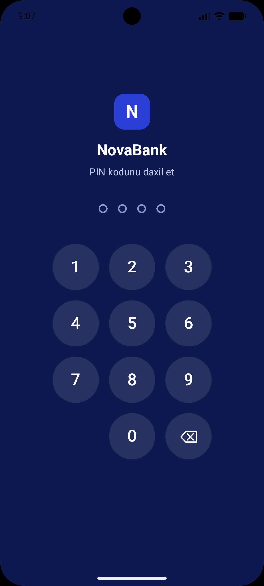
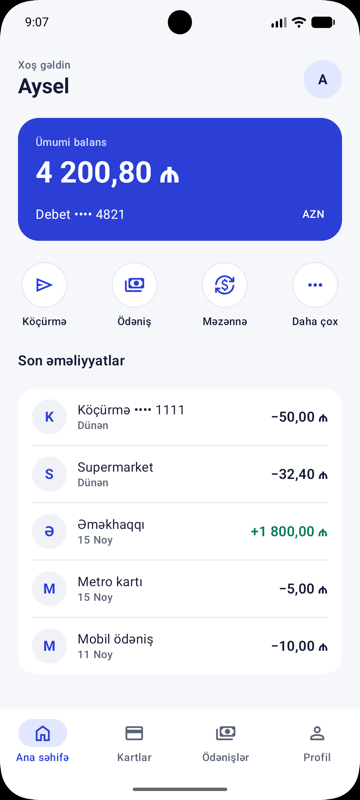
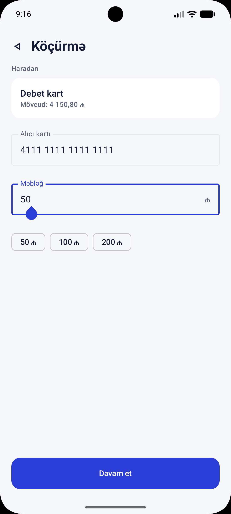
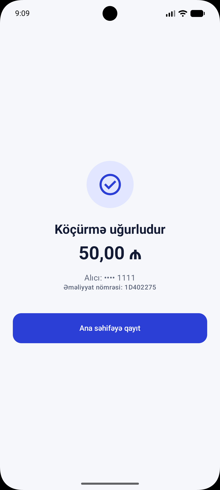

# NovaBank

Mobile banking demo app for Android, built with Kotlin and Jetpack Compose.
Educational project, not a real bank. All data is mock data stored locally.

## Screenshots

  
  
  
  

## Features

- PIN login
- Home screen with account balance and recent transactions
- Money transfer with validation: card number (Luhn check), amount rules, loading and confirmation states
- Local persistence with Room: balance and transactions survive app restarts
- Live updates: after a transfer, the home screen refreshes automatically
- Bottom navigation (Cards, Payments and Profile tabs are placeholders)

## Architecture

Feature-based packages with Clean Architecture layers (presentation, domain, data).

- **Presentation:** Jetpack Compose + ViewModel, unidirectional data flow with `UiState`
- **Domain:** use cases and repository interfaces (pure Kotlin)
- **Data:** Room database as the single source of truth, exposed through Flow
- Money is stored as `Long` minor units (qəpik), never as `Double`
- A transfer runs in one database transaction: the debit and the transaction record are saved together or not at all
- The balance check is enforced in the SQL update itself, not only in the UI

## Tech stack

- Kotlin, Jetpack Compose, Material 3
- MVVM, Clean Architecture
- Hilt (dependency injection)
- Room (local database)
- Coroutines and Flow
- Navigation Compose
- JUnit (unit tests for transfer validation and input formatting)

## Demo access

This is a demo app with mock data.

- PIN: `1234`
- Test card for transfers: `4111 1111 1111 1111` (public test number, passes the Luhn check)
- Try `4111 1111 1111 1112` to see the invalid card error

## Security notes

This is a demo, so some things are intentionally simplified:

- The PIN is hardcoded. A production app would verify a hashed PIN and use the Android Keystore.
- The database is not encrypted. A production app would encrypt it or avoid storing sensitive data locally.
- There is no backend. Real transfers would also be validated on the server.

## Roadmap

- Cards screen (block card, online payments toggle)
- Biometric login
- Profile screen (language, dark mode, logout)
- CI with GitHub Actions

## How to run

1. Clone the repository
2. Open it in Android Studio
3. Run on an emulator or device (minimum SDK 27)